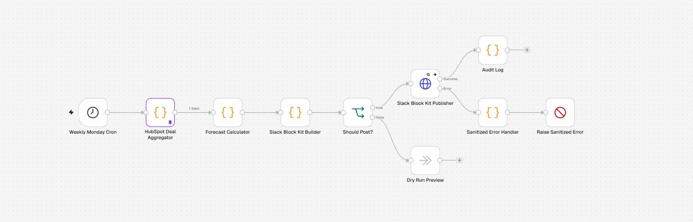
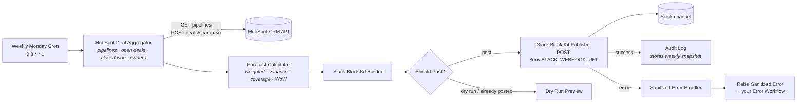

# n8n-hubspot-deal-stage-probability-weighted-forecast-bot

**A weekly reporting bot that pulls open HubSpot deals, calculates a probability-weighted revenue forecast with variance ranges, and posts an executive pipeline summary to Slack every Monday morning.**

I built this as a reference architecture for my solo practice, **dhRobin Systems**. Most leadership teams either read a raw pipeline total that overstates reality, or wait for someone to build a spreadsheet on Monday morning. This workflow does the arithmetic consistently every week: weighted forecast, commit and best case, an expected range, coverage against target, week-over-week movement, and the hygiene issues that make the number less reliable.

> **Safe by default.** The workflow ships with `DRY_RUN=true` and `SANDBOX_MODE=true`. It calls neither HubSpot nor Slack, and runs on a fixed, fictional dataset. Slack posts happen only when you set both flags to `false`. The file contains no tokens, webhook URLs, portal IDs, client names or real deals. Every value is a placeholder.

---

## Table of Contents

1. [Why I Built This](#why-i-built-this)
2. [Architecture](#architecture)
3. [Forecast Formulas](#forecast-formulas)
4. [HubSpot Deal Search Filters](#hubspot-deal-search-filters)
5. [Slack Block Kit Layout](#slack-block-kit-layout)
6. [Repository Structure](#repository-structure)
7. [Prerequisites](#prerequisites)
8. [Setup](#setup)
9. [Cron Schedule Setup](#cron-schedule-setup)
10. [Environment Variables](#environment-variables)
11. [Node Configuration](#node-configuration)
12. [Operational Workflow](#operational-workflow)
13. [Testing](#testing)
14. [Go-Live Checklist](#go-live-checklist)
15. [Security & Privacy Model](#security--privacy-model)
16. [Troubleshooting](#troubleshooting)
17. [Known Limitations](#known-limitations)
18. [Disclaimer & License](#️-disclaimer--liability-limitation)

---

## Why I Built This

"Total pipeline" is the most quoted and least useful number in a revenue meeting. A $250K deal at discovery and a $250K deal with a contract out are not the same money. Stage probabilities already exist in HubSpot, but few teams turn them into a weekly number with a sensible range around it.

This bot gives leadership one consistent view at the same time every week:
- **What we expect to land this quarter**, and how wide the uncertainty is.
- **How that compares with target**, and whether the pipeline covers the gap.
- **What changed since last week.**
- **What is quietly distorting the forecast**: past-due close dates, stale deals, missing amounts.

---

## Architecture





| # | Node | Type | Purpose |
|---|------|------|---------|
| 1 | **Weekly Monday Cron** | Schedule Trigger (v1.2) | Cron `0 8 * * 1`: Mondays at 08:00 in the workflow timezone. |
| 2 | **HubSpot Deal Aggregator** | Code (v2) | Reads pipelines and stage probabilities, pages through open deals in the forecast horizon and closed-won deals this quarter, and resolves owner names. Sandbox returns a fictional dataset. **Ships with pinned sample output.** |
| 3 | **Forecast Calculator** | Code (v2) | Pure maths: weighted forecast, commit and best case, P10–P90 range, coverage, attainment, breakdowns, risks and week-over-week change. |
| 4 | **Slack Block Kit Builder** | Code (v2) | Formats the Block Kit message, enforces Slack limits, escapes CRM text, validates webhook configuration, and applies one-post-per-week idempotency. |
| 5 | **Should Post?** | IF (v2) | Lets only `action = "post"` through. |
| 6 | **Slack Block Kit Publisher** | HTTP Request (v4.2) | `POST` to the incoming-webhook URL read from `$env` at request time. Retries 3×. |
| 7 | **Audit Log** | Code | Records the post and stores the weekly snapshot used for next week's comparison. |
| 8 | **Sanitized Error Handler** | Code | Redacts webhook URLs and tokens, then adds a fix hint for the Slack error code. |
| 9 | **Raise Sanitized Error** | Stop and Error | Fails the run with the clean message so your Error Workflow can alert. |
| 10 | **Dry Run Preview** | No Op | Holds the full Block Kit payload for review. |

**Why the aggregator is a Code node.** A correct forecast needs pipeline stage metadata (probabilities and closed flags), cursor-paged CRM Search with OR'd filter groups, a separate closed-won query, and owner lookups. Putting that in one commented Code node keeps the request logic explicit, rate-limit aware and easy to review. The **HubSpot Deal Search** filters it sends are documented [below](#hubspot-deal-search-filters).

**Why the publisher is an HTTP Request to an incoming webhook.** An incoming webhook is limited to a single channel, needs no bot token, and is the narrowest permission Slack offers for posting a report. If you'd rather use a Slack app bot token and `chat.postMessage`, swap in the n8n **Slack** node (*Send Message → Blocks*) and map `{{ JSON.stringify($json.slackPayload.blocks) }}`.

---

## Forecast Formulas

Each open deal *i* has an amount *aᵢ* and a probability *pᵢ*. By default *pᵢ* is the probability set on its pipeline stage.

| Metric | Formula | Meaning |
|---|---|---|
| **Weighted value** | *wᵢ = aᵢ × pᵢ* | The deal's expected contribution. |
| **Weighted forecast (E)** | *E = Σ aᵢ pᵢ* over deals closing this fiscal quarter | Expected revenue still to land. |
| **Variance** | *Var = Σ aᵢ² pᵢ (1 − pᵢ)* | Treats each deal as an independent win/lose outcome. |
| **Standard deviation** | *σ = √Var* | How far the outcome typically lands from *E*. |
| **Expected range** | *P10 = max(0, E − 1.2816σ)*, *P90 = min(Σaᵢ, E + 1.2816σ)* | Roughly an 80% band (normal approximation). |
| **Closed won QTD** | Σ amount of won deals with close date in the quarter up to today | Already banked. |
| **Projected quarter** | *Closed won QTD + E* | Most likely quarter outcome. |
| **Commit** | *Closed won QTD + Σ aᵢ where pᵢ ≥ COMMIT_PROBABILITY* | Conservative call. |
| **Best case** | *Closed won QTD + Σ aᵢ* | Everything in the quarter closes. |
| **Attainment** | *Closed won QTD ÷ target* | Progress so far. |
| **Projected attainment** | *Projected ÷ target* | Where the quarter is heading. |
| **Gap to target** | *Target − projected* | Negative means ahead. |
| **Coverage ratio** | *Σ aᵢ (quarter) ÷ (target − closed won QTD)* | Pipeline per dollar still needed. Many teams aim for 3×. |
| **Concentration** | *Top-3 weighted ÷ E* | Flagged when ≥ 50%: the quarter depends on very few deals. |
| **Week over week** | Current value − last week's stored snapshot | Weighted forecast, closed won, open pipeline and deal count. |

**Worked example (pinned sample, Q4 FY2026):**

```text
Deal (in quarter)                 Amount   Prob   Weighted   a²·p·(1−p)
Alpha Ltd - Platform            120,000   0.90    108,000   1.296e9
Bravo Inc - Expansion            85,000   0.80     68,000   1.156e9
Charlie GmbH - Pilot (past due)  40,000   0.60     24,000   0.384e9
Delta Co - Enterprise           250,000   0.40    100,000  15.000e9
Echo Partners - Starter          18,000   0.20      3,600   0.052e9
Hotel Retail - Rollout              —     0.20          0   0
Juliet Media - Add-on            22,000   0.90     19,800   0.044e9
Kilo Systems - Renewal           48,000   0.75     36,000   0.432e9
Lima Energy - Renewal            36,000   0.90     32,400   0.117e9
───────────────────────────────────────────────────────────────────────
Σ                               619,000            391,800  18.480e9

σ = √18.480e9 ≈ 135,941      E ± 1.2816σ → 217,578 … 566,022
Closed won QTD = 110,000 + 42,000 + 15,000 = 167,000
Projected = 167,000 + 391,800 = 558,800   (124% of 450,000 target)
Range     = 384,578 … 733,022
Commit    = 167,000 + (120,000 + 85,000 + 22,000 + 36,000) = 430,000
Coverage  = 619,000 ÷ (450,000 − 167,000) = 2.19×
```

**Probability sources** (`PROBABILITY_SOURCE`):
- `stage` (default): the probability configured on each pipeline stage in HubSpot (*Settings → Objects → Deals → Pipelines*).
- `deal_property`: the deal's own `hs_deal_stage_probability`, falling back to the stage value. Use this if your team adjusts probability per deal.
- `STAGE_PROBABILITY_OVERRIDES_JSON` always wins for the stage IDs it lists. For example, `{"contractsent":0.85}` lets finance apply its own historical win rates without changing HubSpot settings.

**Period buckets**, by close date against the run date in UTC:
Past due → This month → Rest of quarter → Next quarter → Later in horizon → No close date.

Past-due deals count in the current quarter by default (`PAST_DUE_TREATMENT=current_quarter`), because they are usually still being worked, and they are always flagged. Set it to `exclude` for a stricter forecast.

---

## HubSpot Deal Search Filters

**1. Pipelines and stage probabilities**
```
GET /crm/v3/pipelines/deals
```
Archived pipelines and stages are ignored. A stage is **closed** when `metadata.isClosed = "true"`, and **won** when it is closed with `metadata.probability = 1.0`. When `PIPELINE_IDS` is set, only those pipelines are kept.

**2. Open deals in the forecast horizon** (two OR'd filter groups, so deals with no close date are still caught)
```json
POST /crm/v3/objects/deals/search
{
  "filterGroups": [
    { "filters": [
      { "propertyName": "pipeline",  "operator": "IN",     "values": ["<pipeline ids>"] },
      { "propertyName": "dealstage", "operator": "NOT_IN", "values": ["<closed stage ids>"] },
      { "propertyName": "closedate", "operator": "LTE",    "value": "<horizon end, epoch ms>" }
    ]},
    { "filters": [
      { "propertyName": "pipeline",  "operator": "IN",     "values": ["<pipeline ids>"] },
      { "propertyName": "dealstage", "operator": "NOT_IN", "values": ["<closed stage ids>"] },
      { "propertyName": "closedate", "operator": "NOT_HAS_PROPERTY" }
    ]}
  ],
  "properties": ["dealname","amount","amount_in_home_currency","closedate","dealstage","pipeline",
                 "hubspot_owner_id","hs_deal_stage_probability","hs_lastmodifieddate","notes_last_updated","createdate"],
  "sorts": [{ "propertyName": "hs_object_id", "direction": "ASCENDING" }],
  "limit": 200,
  "after": "<cursor>"
}
```
The horizon ends at the end of the fiscal quarter `HORIZON_QUARTERS − 1` quarters ahead. The default of 2 covers this quarter and next. Past-due deals are always included, because their close date is before the horizon end.

**3. Closed won this quarter**
```json
{ "filters": [
  { "propertyName": "pipeline",  "operator": "IN",  "values": ["<pipeline ids>"] },
  { "propertyName": "dealstage", "operator": "IN",  "values": ["<won stage ids>"] },
  { "propertyName": "closedate", "operator": "GTE", "value": "<fiscal quarter start>" },
  { "propertyName": "closedate", "operator": "LTE", "value": "<now>" }
]}
```

**4. Owner names (optional)**
`GET /crm/v3/owners`. If the token lacks the owners scope, the bot falls back to `Owner <id>` labels.

**Amounts.** `AMOUNT_PROPERTY` defaults to `amount_in_home_currency`, so multi-currency portals sum in one currency, with `amount` as the fallback. Paging pauses for `PAGE_DELAY_MS` between pages and stops at `MAX_DEALS` (default 5,000; HubSpot Search returns at most 10,000 results per query).

---

## Slack Block Kit Layout

```text
┌─────────────────────────────────────────────────────────────┐
│ 📊 Weekly Pipeline Forecast · Q4 FY2026            [header] │
│ Week of 16 Nov 2026 · Snapshot … · 46 days left   [context] │
├─────────────────────────────────────────────────────────────┤
│ Weighted forecast        │ Projected quarter      [section] │
│ Closed won QTD           │ Quarter target         (fields)  │
│ Expected range P10–P90   │ Commit / Best case               │
│ Open pipeline in quarter │ Coverage ratio                   │
├─────────────────────────────────────────────────────────────┤
│ Week over week  ▲/▼ deltas                        [section] │
├──────────────────────────── divider ────────────────────────┤
│ By close period   (monospace table)               [section] │
│ By stage          (monospace table)               [section] │
│ By pipeline       (shown when >1 pipeline)        [section] │
│ Top owners        (SHOW_OWNER_BREAKDOWN)          [section] │
│ Top N deals       (SHOW_DEAL_NAMES, optional links)[section]│
├──────────────────────────── divider ────────────────────────┤
│ Forecast hygiene & risk                           [section] │
├──────────────────────────── divider ────────────────────────┤
│ Method · totals · "estimates only"                [context] │
└─────────────────────────────────────────────────────────────┘
```

**Rendered sample** (as Slack shows it, from the pinned fictional data):

```text
📊 Weekly Pipeline Forecast · Q4 FY2026
Week of 16 Nov 2026 · Snapshot 16 Nov, 08:00 UTC · 46 days left in quarter · :test_tube: SANDBOX – fictional data
Weighted forecast (Q4 FY2026): $391.8K
Projected quarter: $558.8K · 124% of target
Closed won QTD: $167.0K · 3 deals · 37%
Quarter target: $450.0K · ahead by $108.8K
Expected range (P10–P90): $384.6K – $733.0K
Commit / Best case: $430.0K / $786.0K
Open pipeline in quarter: $619.0K · 9 deals
Coverage ratio: 2.19×
Week over week (vs 2026-W46)
• Weighted forecast: ▲ $19.3K (+5.2%)
• Closed won QTD: ▲ $15.0K (+9.9%)
• Total open pipeline: ▲ $62.0K (+7.6%)  ·  Open deals: ▲ +1 (+8.3%)
────────────────────────────────────────────────────
By close period
Period             Deals     Amount   Weighted
Past due               1     $40.0K     $24.0K
This month             3    $143.0K    $120.2K
Rest of Q4 FY2026      5    $436.0K    $247.6K
Q1 FY2027              3    $185.0K     $96.0K
No close date          1     $70.0K     $28.0K
By stage (probability from pipeline stage settings)
Stage                Prob   #    Amount  Weighted
New·Discovery         20%   2    $18.0K    $3,600
New·Qualified         40%   3   $380.0K   $152.0K
New·Demo / Solution   60%   2   $135.0K    $81.0K
New·Decision Maker …  80%   1    $85.0K    $68.0K
New·Contract Sent     90%   2   $142.0K   $127.8K
Ren·Renewal Open      50%   1    $30.0K    $15.0K
Ren·Negotiation       75%   1    $48.0K    $36.0K
Ren·Verbally Commit…  90%   1    $36.0K    $32.4K
By pipeline
Pipeline             #      Open  Weighted    In qtr
New Business        10   $760.0K   $432.4K   $323.4K
Renewals             3   $114.0K    $83.4K    $68.4K
Top owners by weighted forecast (Q4 FY2026)
Owner                      #     Amount   Weighted
Owner A (placeholder)      3    $182.0K    $151.8K
Owner C (placeholder)      2    $286.0K    $132.4K
Owner B (placeholder)      4    $151.0K    $107.6K
Top 5 deals driving Q4 FY2026
1. Alpha Ltd - Platform (fictional) — $108.0K weighted ($120.0K × 90%) · Contract Sent · closes 15 Dec 2026 · Owner A (placeholder)
2. Delta Co - Enterprise (fictional) — $100.0K weighted ($250.0K × 40%) · Qualified · closes 20 Dec 2026 · Owner C (placeholder)
3. Bravo Inc - Expansion (fictional) — $68.0K weighted ($85.0K × 80%) · Decision Maker Bought-In · closes 28 Nov 2026 · Owner B (placeholder)
4. Kilo Systems - Renewal (fictional) — $36.0K weighted ($48.0K × 75%) · Negotiation · closes 31 Dec 2026 · Owner B (placeholder)
5. Lima Energy - Renewal (fictional) — $32.4K weighted ($36.0K × 90%) · Verbally Committed · closes 20 Nov 2026 · Owner C (placeholder)
────────────────────────────────────────────────────
Forecast hygiene & risk
:warning: 1 past-due deal worth $40.0K (close date already passed, still counted in this quarter)
:hourglass: 2 deals worth $100.0K not updated in 21+ days
:grey_question: 1 open deal has no amount (counted as $0)
:calendar: 1 open deal worth $70.0K has no close date
:dart: Top 3 deals make up 70% of the weighted forecast
────────────────────────────────────────────────────
Method: weighted = Σ amount × stage probability · range = expected ± 1.28σ (independent outcomes) · commit = closed won + deals ≥ 80%.
13 open deals in a 2-quarter horizon ($874.0K total, $515.8K weighted).
Estimates only, not financial guidance · n8n forecast bot by dhRobin Systems.
```

**Slack limits enforced by the builder:** at most 50 blocks, section text ≤ 3,000 characters, ≤ 10 fields per section, header ≤ 150 characters. Long tables are clipped with a "(truncated)" marker. Every deal, stage and owner name is escaped (`&`, `<`, `>`), so CRM text can't trigger `@channel`, mentions or links. `unfurl_links` and `unfurl_media` are turned off.

To preview or restyle the layout, run in dry-run mode, copy `slackPayload.blocks` from **Dry Run Preview**, and paste it into Slack's **Block Kit Builder**.

---

## Repository Structure

```
n8n-hubspot-deal-stage-probability-weighted-forecast-bot/
├── README.md          ← this guide
├── workflow.json      ← importable n8n workflow (pinned fictional deal data)
├── DISCLAIMER.md      ← liability limitation + license notice
└── LICENSE            ← MIT License
```

---

## Prerequisites

- **n8n** 1.x (self-hosted or Cloud) with access to environment variables from inside nodes.
- A **HubSpot** account. **Start with a developer test account or sandbox.**
- A HubSpot **private app** token with read access to deals and deal pipelines (`crm.objects.deals.read`), plus optional read access to owners for names. Check the current scope names in the HubSpot API reference.
- A **Slack incoming webhook** for a restricted executive channel. Create a Slack app, turn on *Incoming Webhooks*, add one to the channel, and copy the URL into an env var. **Never paste it into the workflow.**
- Stage probabilities configured in HubSpot for every open stage in the pipelines you forecast.

| n8n setting | Value | Why |
|---|---|---|
| `N8N_BLOCK_ENV_ACCESS_IN_NODE` | `false` | The Code and HTTP nodes read `$env.*`. |
| `GENERIC_TIMEZONE` | e.g. `Asia/Dhaka` | Instance default timezone for schedules (the workflow setting overrides it). |

> **No env access allowed?** Store the HubSpot token in an n8n *HubSpot App Token* credential and change the aggregator's `this.helpers.httpRequest` call to `this.helpers.httpRequestWithAuthentication.call(this, 'hubspotAppToken', options)`. For Slack, use the n8n Slack node with a bot-token credential.

---

## Setup

1. **Import:** go to **Workflows → Import from File** and select `workflow.json`. It imports **inactive**.
2. **Look at the sample:** click **Execute Workflow**. The pinned aggregator output feeds the calculator and builder. Open **Dry Run Preview** to see the full message.
3. **Set environment variables:** copy the block below into your n8n environment. Keep both safety flags `true` and restart n8n.
4. **Set the schedule timezone:** go to *Workflow Settings → Timezone* (see [Cron Schedule Setup](#cron-schedule-setup)).
5. **Unpin the sample:** right-click **HubSpot Deal Aggregator → Unpin**. Otherwise manual runs keep using the fictional data.
6. **Shadow mode:** set `SANDBOX_MODE=false` and keep `DRY_RUN=true`. Run manually against your **test** portal and reconcile the numbers with HubSpot's own reports.
7. **Go live:** set `DRY_RUN=false`, check the webhook points at the right channel, and turn the workflow **Active**.

---

## Cron Schedule Setup

The **Weekly Monday Cron** node uses a cron expression:

```
0 8 * * 1
│ │ │ │ └── day of week (1 = Monday)
│ │ │ └──── month (every)
│ │ └────── day of month (every)
│ └──────── hour (08)
└────────── minute (00)
```

| Goal | Expression |
|---|---|
| Mondays 08:00 (default) | `0 8 * * 1` |
| Mondays 07:30 | `30 7 * * 1` |
| Mondays and Thursdays 08:00 | `0 8 * * 1,4` |
| First business day check-in (every weekday 08:00, then filter in code) | `0 8 * * 1-5` |
| Fridays 16:00 (weekly close) | `0 16 * * 5` |

**Timezone:** the workflow ships with `settings.timezone = "UTC"`. Change it under **Workflow Settings → Timezone** to your leadership team's timezone, such as `Asia/Dhaka`, `America/New_York` or `Europe/London`, so "Monday 08:00" means their Monday morning. `REPORT_TIMEZONE` controls only how dates are **displayed** in Slack. Period boundaries (month, quarter, past due) are calculated in UTC.

**One post per week:** the builder records the ISO week (for example `2026-W47`) after a successful post and skips any later run in the same week. Set `FORCE_REPOST=true` for a deliberate resend.

---

## Environment Variables

```dotenv
# ---------- Safety switches (fail-safe: ON unless exactly "false") ----------
DRY_RUN=true                     # true = build the message but never post
SANDBOX_MODE=true                # true = fictional dataset, no HubSpot or Slack calls
FORCE_REPOST=false               # opt-in: allow a second post in the same ISO week

# ---------- HubSpot ----------
HUBSPOT_ACCESS_TOKEN=YOUR_HUBSPOT_PRIVATE_APP_TOKEN
HUBSPOT_PORTAL_ID=               # optional, numeric: adds deal links in Slack
PIPELINE_IDS=                    # optional, comma-separated; empty = all pipelines
AMOUNT_PROPERTY=amount_in_home_currency
HORIZON_QUARTERS=2               # this quarter + next
FISCAL_YEAR_START_MONTH=1        # 1 = January; 4 = April; 7 = July …
MAX_DEALS=5000
PAGE_DELAY_MS=250
INCLUDE_OWNER_NAMES=true

# ---------- Forecast maths ----------
PROBABILITY_SOURCE=stage         # stage | deal_property
STAGE_PROBABILITY_OVERRIDES_JSON=   # e.g. {"contractsent":0.85,"qualifiedtobuy":0.3}
QUARTER_TARGET=                  # e.g. 450000 (in AMOUNT_PROPERTY currency); empty hides target metrics
COMMIT_PROBABILITY=0.8
PAST_DUE_TREATMENT=current_quarter   # current_quarter | exclude
STALE_DAYS=21
TOP_DEALS_COUNT=5
TOP_OWNERS_COUNT=5
REPORT_DATE_OVERRIDE=            # ISO date for backtesting, e.g. 2026-11-16T08:00:00Z

# ---------- Slack ----------
SLACK_WEBHOOK_URL=https://hooks.slack.com/services/YOUR/WEBHOOK/PATH
SLACK_WEBHOOK_URL_SECONDARY=     # optional second channel (e.g. finance)
REPORT_TITLE=Weekly Pipeline Forecast
CURRENCY_CODE=USD
REPORT_TIMEZONE=UTC              # display only
SHOW_DEAL_NAMES=true             # false = show "Deal <id>" instead of names
SHOW_OWNER_BREAKDOWN=true
```

| Variable | Default | Description |
|---|---|---|
| `DRY_RUN` | `true` | Anything other than `false` means build and preview only. |
| `SANDBOX_MODE` | `true` | Anything other than `false` means fictional data, no API calls, and dry run forced. |
| `FORCE_REPOST` | `false` | Bypass the one-post-per-week guard. |
| `HUBSPOT_ACCESS_TOKEN` | — | Required when `SANDBOX_MODE=false`. |
| `HUBSPOT_PORTAL_ID` | empty | Numeric portal ID, used only to build deal links in Slack. |
| `PIPELINE_IDS` | all | Limit the forecast to specific pipelines. |
| `AMOUNT_PROPERTY` | `amount_in_home_currency` | Deal property that is summed (falls back to `amount`). |
| `HORIZON_QUARTERS` | `2` | How many fiscal quarters of open deals to load (1–8). |
| `FISCAL_YEAR_START_MONTH` | `1` | Fiscal calendar. FY labels use the year the fiscal year ends. |
| `MAX_DEALS` / `PAGE_DELAY_MS` | `5000` / `250` | Paging safety and rate-limit courtesy. |
| `INCLUDE_OWNER_NAMES` | `true` | Resolve owner names (needs the owners scope). |
| `PROBABILITY_SOURCE` | `stage` | Where *pᵢ* comes from. |
| `STAGE_PROBABILITY_OVERRIDES_JSON` | empty | `{stageId: probability}` overrides. |
| `QUARTER_TARGET` | empty | Enables attainment, gap and coverage metrics. Sandbox uses a fictional 450,000. |
| `COMMIT_PROBABILITY` | `0.8` | Threshold for the commit number. |
| `PAST_DUE_TREATMENT` | `current_quarter` | Whether past-due deals count in this quarter. |
| `STALE_DAYS` | `21` | Days without an update before a deal is flagged stale. |
| `TOP_DEALS_COUNT` / `TOP_OWNERS_COUNT` | `5` / `5` | List lengths (0 hides the list). |
| `REPORT_DATE_OVERRIDE` | empty | Run "as of" a past date for backtests. |
| `SLACK_WEBHOOK_URL` | — | Primary channel. Must be `https://hooks.slack.com/services/…`. |
| `SLACK_WEBHOOK_URL_SECONDARY` | empty | Optional second channel. |
| `REPORT_TITLE` / `CURRENCY_CODE` / `REPORT_TIMEZONE` | see above | Presentation only. |
| `SHOW_DEAL_NAMES` / `SHOW_OWNER_BREAKDOWN` | `true` | Turn these off for wider audiences. |

**Mode matrix**

| `SANDBOX_MODE` | `DRY_RUN` | HubSpot reads | Slack post | Use for |
|---|---|---|---|---|
| `true` | any | ❌ fictional | ❌ preview | First import, layout review |
| `false` | `true` | ✅ | ❌ preview | Shadow mode, reconciliation |
| `false` | `false` | ✅ | ✅ | **Live** weekly report |

---

## Node Configuration

### 1. Weekly Monday Cron
- Schedule Trigger → *Custom (Cron)* → `0 8 * * 1`. The timezone comes from workflow settings.

### 2. HubSpot Deal Aggregator (*Run Once for All Items*)
- Sections: Configuration → Period maths → Helpers → Sandbox dataset → Live loaders → Main.
- Output (one item): `meta`, `periods` (as-of, ISO week, month, fiscal quarter, next quarter, horizon end), `pipelines[]`, `deals[]`, `closedWon[]`, `owners{}` and `previousSnapshot`.
- Retries 429 and 5xx responses up to 4 times with backoff. Any other failure throws a **sanitised** error: endpoint path and status only, with tokens redacted.
- 📌 **Pinned data:** the sandbox output is pinned, so a manual run works straight after import. **Unpin before you test live.** Scheduled (active) executions always run the node itself.

### 3. Forecast Calculator (*Run Once for All Items*)
- Output: `totals`, `quarter`, `nextQuarter`, `byPeriod[]`, `byStage[]`, `byPipeline[]`, `byOwner[]`, `topDeals[]`, `risks`, `wow` and `snapshot`.
- Deals in unknown stages are weighted at 0 and flagged. Deals in closed stages are dropped.

### 4. Slack Block Kit Builder (*Run Once for All Items*)
- One output item per destination (`PRIMARY`, plus `SECONDARY` when configured).
- In live mode it checks that each webhook URL matches `https://hooks.slack.com/services/…`. **URLs are never copied into item data.**

| `action` | Meaning |
|---|---|
| `post` | Goes to the publisher. |
| `dry_run_preview` | Preview only (`DRY_RUN` or `SANDBOX_MODE`). |
| `skip_already_posted` | This ISO week was already posted live. |

### 5. Should Post?
- `{{ $json.action }}` equals `post`.

### 6. Slack Block Kit Publisher
- `POST {{ $json.destination === 'SECONDARY' ? $env.SLACK_WEBHOOK_URL_SECONDARY : $env.SLACK_WEBHOOK_URL }}`
- Body: `{{ JSON.stringify($json.slackPayload) }}` → `{ text, blocks, unfurl_links: false, unfurl_media: false }`.
- Response format **text** (Slack webhooks answer `ok`). 3 tries, 3 s apart. Error output → Sanitized Error Handler.

### 7–10. Audit Log · Sanitized Error Handler · Raise Sanitized Error · Dry Run Preview
- **Audit Log** keeps the last 26 weekly snapshots in workflow static data. These drive the week-over-week deltas.
- **Sanitized Error Handler** redacts `hooks.slack.com` URLs and `xox…` tokens and maps 400/403/404/410/429 to fix hints.
- Point *Workflow Settings → Error Workflow* at your alerting workflow so a failed Monday report is never silent.

---

## Operational Workflow

1. **Monday 08:00:** the cron fires.
2. The aggregator loads pipeline settings, every open deal closing within the horizon (plus undated ones), and this quarter's closed-won deals.
3. The calculator weights every deal, works out the quarter's expected outcome and range, compares it with target and last week, and lists the hygiene issues.
4. The builder formats a single Block Kit message per channel and checks the week hasn't already been posted.
5. The publisher posts to Slack. The audit log stores this week's snapshot for next Monday's comparison.
6. Any failure raises a sanitised alert, so a missing report never goes unnoticed.

**Using the report well**
- Read **Projected quarter** together with its **P10–P90 range**. A wide range means the quarter rests on a few large, uncertain deals, and the concentration flag says so.
- Use the **hygiene section** as the Monday agenda: past-due close dates and stale deals distort every number above them.
- Revisit stage probabilities every quarter against your actual historical win rates. Use `STAGE_PROBABILITY_OVERRIDES_JSON` to trial new values before you change them in HubSpot.

---

## Testing

### Stage 1: Sandbox
Execute manually. In **Forecast Calculator**, the pinned sample gives:

| Metric | Value |
|---|---|
| Weighted forecast Q4 FY2026 | $391,800 |
| Closed won QTD | $167,000 (3 deals) |
| Projected quarter | $558,800 (124% of the fictional $450,000 target) |
| Expected range (projected) | $384,578 – $733,022 |
| Commit / Best case | $430,000 / $786,000 |
| Coverage ratio | 2.19× |
| Week over week (weighted) | ▲ $19,300 (+5.2%) |

Check **Dry Run Preview → slackPayload** in Block Kit Builder.

### Stage 2: Shadow mode (`SANDBOX_MODE=false`, `DRY_RUN=true`, **unpinned**)
Run against your **HubSpot test account**. Reconcile:
- Open deal count and amount against a HubSpot deals view filtered the same way.
- The weighted total against HubSpot's *Weighted amount* on a deal report.
- Closed won QTD against your closed-won report.

### Stage 3: Backtest
Set `REPORT_DATE_OVERRIDE` to a past Monday to see what the bot would have said then. This is only approximate, because deals have changed since.

### Stage 4: Live post to a private test channel
Point `SLACK_WEBHOOK_URL` at a private test channel and set `DRY_RUN=false`. Run once and confirm the layout. Run again to confirm `skip_already_posted`.

---

## Go-Live Checklist

- [ ] Stage probabilities reviewed for every open stage in the forecast pipelines
- [ ] `PIPELINE_IDS`, `AMOUNT_PROPERTY` and `FISCAL_YEAR_START_MONTH` match how finance reports
- [ ] `QUARTER_TARGET` set and agreed with finance (update it each quarter)
- [ ] Shadow-mode numbers reconciled with HubSpot reports
- [ ] Webhook points at a **restricted** executive or finance channel
- [ ] `SHOW_DEAL_NAMES` / `SHOW_OWNER_BREAKDOWN` agreed for that channel's audience
- [ ] Workflow timezone set and **sample data unpinned**
- [ ] Error Workflow configured and tested
- [ ] n8n execution-data retention set to match your data policy (executions contain deal data)

---

## Security & Privacy Model

- **No secrets in the repo.** The HubSpot token and Slack webhook URLs live only in environment variables. `workflow.json` contains placeholders and fictional data only.
- **Webhook URLs never enter execution data.** The builder only checks them. The publisher resolves them from `$env` at request time, so they don't show up in item JSON or logs.
- **The token goes to one host only.** The HubSpot base URL is hard-coded to `https://api.hubapi.com`.
- **Read-only CRM access.** The bot never writes to HubSpot.
- **Output escaping.** CRM text is escaped before it reaches Slack, which blocks `@channel` / `<!here>` injection and link spoofing from deal names.
- **Least exposure.** Deal names, owner names and deal links can each be turned off for wider audiences.
- **Sanitised errors.** Errors carry status codes and hints, never URLs, tokens or forecast figures.
- **Fail-safe flags.** Any value other than exactly `false` keeps `DRY_RUN` and `SANDBOX_MODE` on.

---

## Troubleshooting

| Symptom | Likely cause | Fix |
|---|---|---|
| Live run still shows fictional deals | Aggregator output is still pinned | Right-click the node → **Unpin**. |
| `access to env vars denied` | Env access is blocked in nodes | Set `N8N_BLOCK_ENV_ACCESS_IN_NODE=false`, or use credentials (see Prerequisites). |
| `HubSpot … failed (HTTP 403)` | Missing deals or pipelines read scope | Add the scope to the private app. |
| Weighted total is far below HubSpot's | Stage probabilities are 0 or unset, or `PROBABILITY_SOURCE` differs | Check pipeline settings, or set the overrides. |
| Totals in mixed currencies | `AMOUNT_PROPERTY=amount` in a multi-currency portal | Use `amount_in_home_currency`. |
| "deal cap reached" note | More open deals than `MAX_DEALS` | Narrow `PIPELINE_IDS` or `HORIZON_QUARTERS`, or raise `MAX_DEALS` (≤ 10,000). |
| Slack 400 `invalid_blocks` | Block edited by hand, or an unusual character | Paste the preview into Block Kit Builder. |
| Slack 404 `no_service` | Webhook revoked | Create a new incoming webhook. |
| Report posted at the wrong hour | Workflow timezone still `UTC` | Change it in Workflow Settings. |
| No week-over-week section | First live week, or static data reset | It appears after the second successful live post. |

---

## Known Limitations

- **Independence assumption.** The P10–P90 range assumes deals win or lose independently. Correlated outcomes, such as one budget freeze hitting many deals, make the real range wider.
- **Probabilities are configuration, not evidence.** The forecast is only as good as the stage probabilities. Calibrate them against historical win rates every quarter.
- **UTC period boundaries.** Month and quarter edges are calculated in UTC. Deals that close on the boundary day in far-off timezones can land in the neighbouring period.
- **Point-in-time week over week.** Snapshots are stored after successful live posts only. Skipped weeks are compared with the most recent stored week.
- **Search API ceiling.** HubSpot Search returns at most 10,000 results per query. Very large portals should split by pipeline.
- **Single currency display.** `CURRENCY_CODE` only sets the symbol. No conversion is applied beyond what HubSpot's home-currency amount already provides.

---

## ⚠️ Disclaimer & Liability Limitation

**Use at your own risk.** The code, workflows, and scripts in this repository (`n8n-hubspot-deal-stage-probability-weighted-forecast-bot`) are provided for educational and architectural demonstration purposes.

* **No Liability:** The author and dhRobin Systems accept no responsibility or liability for any direct, indirect, incidental, or consequential damages that result from using, misusing, or deploying these scripts.
* **No Warranty:** All software, n8n JSON blueprints, and JavaScript modules are provided "AS IS", without warranty of any kind, express or implied. This includes, but is not limited to, warranties of merchantability, fitness for a particular purpose, and non-infringement.
* **Production Testing Required:** Always test thoroughly in an isolated staging environment, such as a HubSpot developer test account or sandbox, with `SANDBOX_MODE=true` and `DRY_RUN=true` enabled, before you connect live HubSpot credentials or a live Slack channel. Forecasts are estimates, not financial statements or guidance, and must be reconciled with HubSpot reports before anyone relies on them.
* **Third-Party APIs & Compliance:** You alone are responsible for complying with the terms of service, rate limits, data privacy regulations (GDPR/CCPA), and security policies of HubSpot, Slack and any connected services. That includes deciding who may see pipeline, customer and owner data, posting only to appropriately restricted channels, and meeting any confidentiality obligations that apply to revenue information.

The full disclaimer is also available in [DISCLAIMER.md](https://github.com/dhrobinsystems/n8n-hubspot-deal-stage-probability-weighted-forecast-bot/blob/main/DISCLAIMER.md).

## License

Released under the MIT License. Copyright (c) 2026 DH Robin (dhRobin Systems). See [LICENSE](https://github.com/dhrobinsystems/n8n-hubspot-deal-stage-probability-weighted-forecast-bot/blob/main/LICENSE).

---

Full text: DISCLAIMER.md · Licensed under the MIT License. License: MIT © 2026 DH Robin (dhRobin Systems) · Provided as-is, see the disclaimer.
